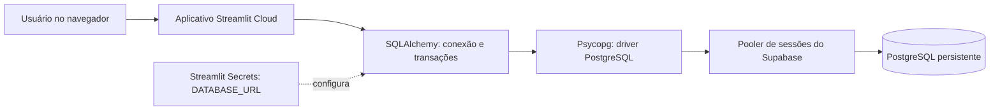

# Integração do sistema com Supabase

## Objetivo

Este documento explica por que o armazenamento do sistema foi transferido do
SQLite local para o PostgreSQL do Supabase, qual é o papel de cada tecnologia e
como os dados percorrem o sistema.

O objetivo principal foi manter os registros do aplicativo em um banco
persistente e compartilhado. Um arquivo SQLite no computador ou no ambiente
temporário do Streamlit Cloud não é uma fonte confiável para os dados de um
aplicativo publicado.

## Visão geral



O usuário interage com o aplicativo Streamlit. O código acessa o PostgreSQL por
meio do SQLAlchemy e do driver Psycopg. A URL de conexão vem dos Secrets do
Streamlit, não de uma senha escrita no código.

## Papel de cada tecnologia

- **Streamlit:** hospeda e executa a interface Python do aplicativo. O Streamlit
  Cloud pode reiniciar ou recriar o ambiente da aplicação; por isso, o banco de
  dados não deve depender de um arquivo local nesse ambiente.
- **Supabase:** fornece o serviço PostgreSQL persistente, onde ficam as tabelas
  e os dados compartilhados pela aplicação.
- **Pooler de sessões do Supabase:** intermedeia as conexões ao banco. Foi
  escolhido para o Streamlit Cloud porque a conexão direta do Supabase pode
  exigir IPv6, enquanto o pooler é apropriado para conexões por IPv4. A URI,
  usuário e porta devem ser copiados da opção Session Pooler do projeto.
- **SQLAlchemy:** cria e administra o motor de conexão, transações e ciclo de
  vida das conexões. Ele é a camada usada pelo código Python para executar SQL.
- **Psycopg:** é o driver que efetivamente fala o protocolo PostgreSQL entre o
  SQLAlchemy e o banco. O projeto instala `psycopg[binary]` pelas dependências.
- **Streamlit Secrets:** guarda `DATABASE_URL` fora do repositório. Isso evita
  publicar credenciais no GitHub e permite atualizar a senha sem modificar o
  código.
- **SQLite:** continua sendo usado apenas como origem opcional na migração dos
  dados locais antigos. Não é o banco usado pelo aplicativo publicado após a
  integração.

## Por que cada alteração foi necessária

### Uma única base para os dados da aplicação

Inicialmente, o código criava tabelas no PostgreSQL, mas outras partes do
aplicativo e a autenticação ainda usavam SQLite. Isso dividia a persistência:
uma tela podia consultar um banco enquanto outra gravava em outro. As funções
de leitura e escrita do aplicativo, junto com a autenticação e a gestão de
usuários, foram encaminhadas ao PostgreSQL para que os dados fiquem no mesmo
lugar.

### Segredo de conexão fora do código

A URL contém informações de acesso ao banco. Por isso, a configuração foi
alterada para ler `DATABASE_URL` do Streamlit Secrets ou de uma variável de
ambiente local. A chave precisa se chamar exatamente `DATABASE_URL`, pois é o
nome procurado pelo código.

No Streamlit Cloud, o valor é configurado em **Manage app > Settings >
Secrets**. Localmente, pode ser configurado em `.streamlit/secrets.toml`. Esse
arquivo não deve ser enviado ao Git.

### Compatibilidade com consultas já existentes

O aplicativo já tinha consultas escritas no estilo SQLite, incluindo `?` como
marcador de parâmetros e leitura de linhas por posição. Foi criado um adaptador
para converter os parâmetros e preservar o formato de linha esperado pelo
código, reduzindo a necessidade de reescrever todas as consultas de negócio de
uma vez.

O adaptador também precisou distinguir consultas que retornam linhas de
comandos como `CREATE TABLE`, que não retornam. A correção evita que a
inicialização tente acessar colunas inexistentes em resultados DDL.

### Tabelas e alterações de estrutura

Ao iniciar, `init_db()` cria as tabelas usadas pelo sistema no PostgreSQL e
adiciona algumas colunas que podem faltar em tabelas existentes. Isso prepara a
estrutura do banco; não copia automaticamente os dados do arquivo SQLite.

### Migração dos dados locais

O script `migrate_database.py` foi criado para importar dados do arquivo local
`central_comando.db` para tabelas compatíveis no PostgreSQL. Ele mantém o
arquivo de origem, preserva os IDs quando possível e registra que a migração foi
executada para evitar uma nova importação integral acidental.

Essa migração é opcional e deve ser executada em um computador que tenha o
arquivo SQLite. Ela importa os dados que estão nesse arquivo, inclusive
registros de teste e contas locais; não copia o código, arquivos de planilha,
segredos, nem busca automaticamente dados que tenham ficado no armazenamento
temporário do Streamlit Cloud.

Para executá-la, configure `DATABASE_URL` localmente e rode na pasta do projeto:

```powershell
py -m pip install -r requirements.txt
py migrate_database.py
```

Se não for necessário manter os dados locais antigos, não é preciso executar a
migração. O aplicativo publicado continuará gravando novos registros no
Supabase.

## Erros encontrados e o que ensinaram

- **Host `://supabase.com` não encontrado:** a configuração inicial tinha um
  host inválido. A correção foi usar a URI completa copiada do Supabase.
- **Falha de autenticação:** o servidor estava acessível, mas rejeitava o
  usuário e/ou a senha. A URI do pooler deve ser copiada com o usuário exato
  informado pelo Supabase e a senha atual do banco. Caracteres especiais na
  senha precisam ser codificados para URL; por exemplo, `@` vira `%40`.
- **`ResourceClosedError` na criação das tabelas:** a conexão já funcionava,
  mas o adaptador tentava ler linhas de um comando que não retorna linhas. O
  tratamento foi ajustado para só acessar resultados de consultas que retornam
  linhas.

Esses erros mostram que conexão de rede, autenticação e execução de SQL são
etapas diferentes. O log mais interno costuma indicar em qual delas ocorreu a
falha.

## Segurança e operação

- Nunca coloque `DATABASE_URL` ou a senha do banco no código, README, GitHub ou
  mensagens de suporte.
- Se uma senha for exposta, troque-a no Supabase e atualize o Secret no
  Streamlit Cloud.
- Use a URI, o usuário e a porta exibidos em **Supabase > Connect > Session
  Pooler**; não invente ou substitua esses valores manualmente.
- Depois de alterar Secrets, reinicie o aplicativo para que a nova
  configuração seja carregada.
- O repositório inclui o código da integração e o script de migração. O arquivo
  `central_comando.db` é local e não é enviado automaticamente ao Streamlit
  Cloud.

## Resultado

Com a configuração de conexão válida, o aplicativo pode criar as tabelas e
persistir os novos registros no PostgreSQL do Supabase. O código dessa
integração foi publicado na branch `main`; a migração dos dados SQLite antigos
é uma ação separada, executada somente se esses dados precisarem ser mantidos.